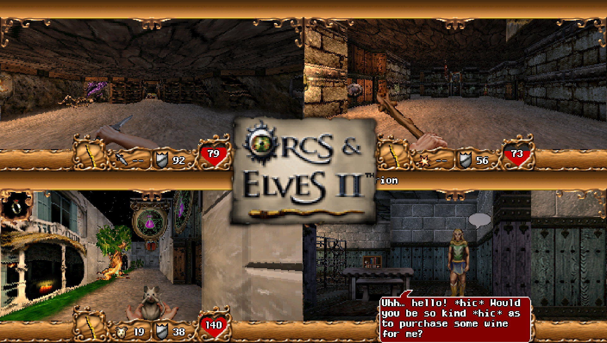

# Orcs & Elves II (PlayStation Vita Port)



## Features

- **Widescreen patch:** Renders at `352×200` widescreen (instead of the original `176×220` phone layout) scaled to the PS Vita's `960×544` screen.
- **Remastered lighting:** Adds real-time point lighting, geometric ray shadows, contact ambient occlusion, and projectile impact flashes while keeping all original BREW textures and sprites, switchable in Options with Classic mode.
- **Faithful simulation:** Preserves the original BREW gameplay and RNG, with a **Speed** setting in Options (`Fast` 60 Hz default, or `Slow` 25 Hz original timing).
- **Fully tested:** Completely playable and tested from start to finish on real PlayStation Vita hardware.

## Installation

- Obtain official game files (e.g. from [Internet Archive](https://archive.org/details/oe2_brew)), and copy them to `ux0:data/oe2/` on your Vita.
- Download the [latest release](https://github.com/sweetpalma/oe-2-vita/releases).
- Install `oe2.vpk` on your Vita.
- Enjoy!

## Controls

- **Movement & Turning:**
  - **D-Pad:** Movement and menu navigation.
  - **Triggers:** Strafing.
- **Actions & Combat:**
  - **Cross (`X`):** Attack or interact.
  - **Triangle (`△`):** Cycle weapons or skip dialogues.
  - **Square (`□`):** Skip turn.
  - **Circle (`○`):** Cancel.
- **System:**
  - **Start:** Pause.
  - **Select:** Map.

## Building

Builds produce standalone executables and packages without bundling proprietary game data, ready for clean distribution.

### Docker

Building with Docker is the easiest way.

```sh
# Build PS Vita .vpk
docker compose run --rm --build vita

# Build PC Linux binary (build/oe2)
docker compose run --rm --build pc
```

### Local Build

To build the standard PS Vita package (`oe2.vpk` without bundled game data; requires VitaSDK at `tools/vendor/vitasdk` or `VITASDK` environment variable):

```sh
python3 tools/build_vita.py
```

To build for PC locally (requires CMake and SDL2):

```sh
python3 tools/build_pc.py
```

You can also pass `--bundle-data` to bundle `orcsandelves2.bar` and `orcsandelves2.mod` directly inside the `.vpk` (requires the files in `data/`). This is intended **strictly for local debug and testing purposes**, not for distribution.

```sh
python3 tools/build_vita.py --bundle-data
```

## License

This project is distributed under the GNU General Public License v3.0. See [LICENSE](LICENSE) for the full license text, and [SOURCES.md](SOURCES.md) for upstream provenance and author credits.

Original game assets (`orcsandelves2.bar` and `orcsandelves2.mod`) are the property of id Software and Fountainhead Entertainment and are not included in this repository.
